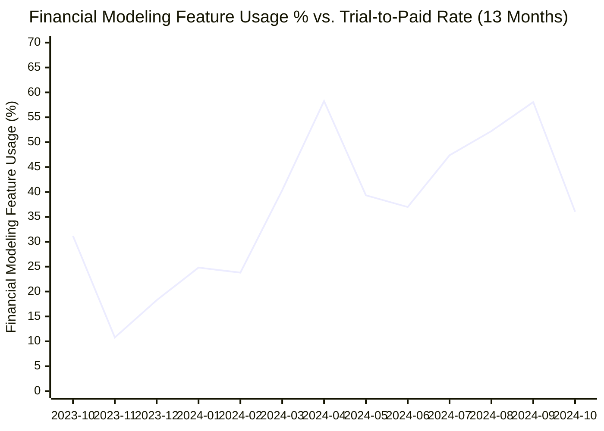
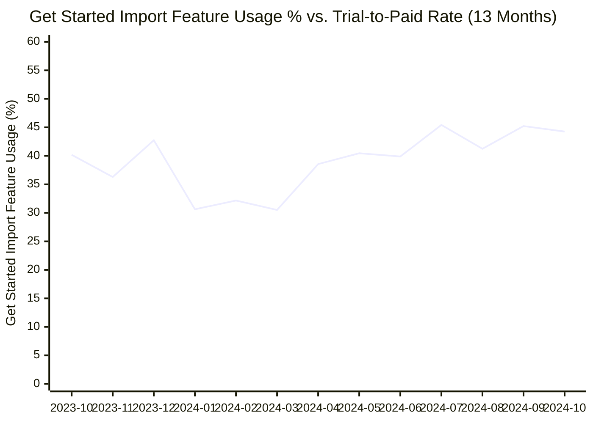

# The Signals · FinWise

> Module 4 · Data & Analytics. The data pattern you found and the indicators you'll steer by.

## The data pattern

A. Plot 1: Financial Modeling Usage % vs. Trial-to-Paid Conversion Rate

The Pattern: Extreme volatility in modeling usage (swinging wildly between 10.8% and 58.3%) contrasted against an unmoving, flat line for trial-to-paid conversion (locked tightly at ~1.9%–2.1%).

The Revelation: Engagement does not automatically equal monetization. Months where user adoption of forward-looking modeling spiked by nearly 5x yielded zero meaningful increase in paid conversions. This proves that users are experiencing the product’s core functionality during the trial, but the transition from using the tool to paying for the tool is broken.

B. Plot 2: Get Started Import Feature Usage % vs. Trial-to-Paid Conversion Rate

The Pattern: Import usage holds a relatively stable baseline band (30.5%–45.4%), while correlation with paid conversion is non-existent (-0.050).

The Revelation: Administrative setup is a prerequisite, not a conversion trigger. Completing basic onboarding tasks (linking bank feeds or importing data) merely places a user at the starting line. It does not deliver enough perceived value on its own to convince a user to swipe their credit card when the trial ends.

_Metric patterns: Conversion, ceiling (flat capped performance). Modeling usage, cliff or volatile swings (sharp drop offs and spikes). Import usage, slow leak (stagnate low baseline setup). Session duration, slow leak or inverse divergence. Sessions/user, cliff (erratic engagement drops)._

_Correlation test: Revised._

_____

## Leading indicators

- **Financial Modeling Feature Usage %:** This metric sits directly downstream of North Star definition ("reach their first modeling output") and targets the exact behavior that fixes FinWise's long-term value realization and churn problem.
- **Get Started Import Feature Usage %:** Data import is the mandatory prerequisite to modeling. You cannot generate a financial model without real linked bank feeds or imported data.

_____

## Lagging indicators

- **Visit-to-Trial Conversion Rate:** Visit-to-Trial Conversion Rate reflects the final outcome of the entire top-of-funnel acquisition journey. It tells how many people completed sign-up, but it doesn't give real-time visibility into user intent or friction during the session.

_____
